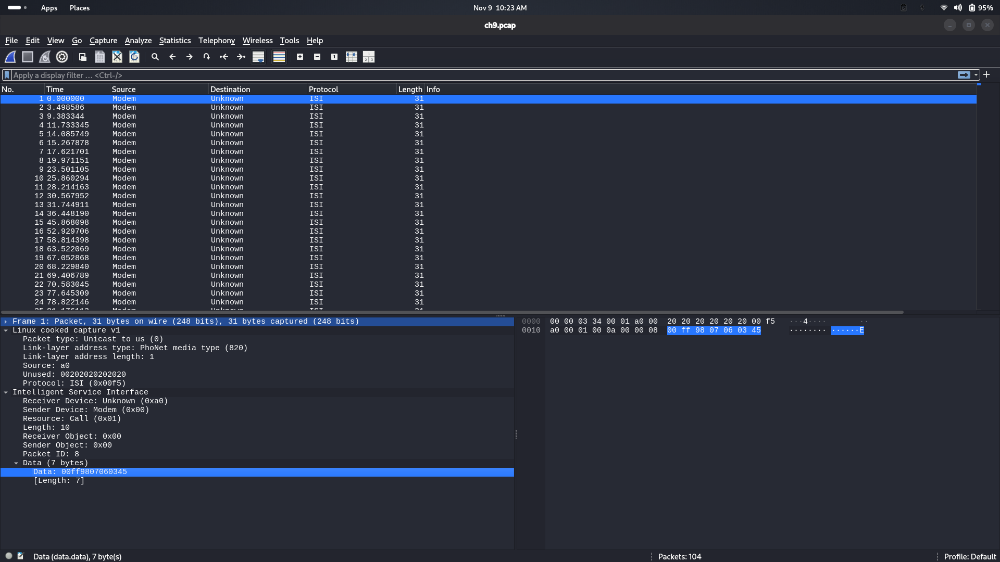
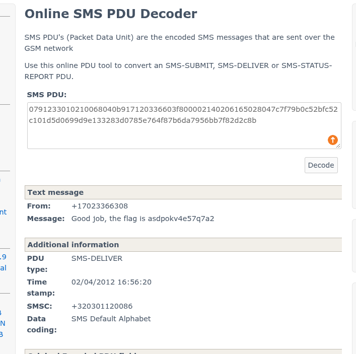

# [Global System Traffic for Mobile Communication](https://www.root-me.org/en/Challenges/Network/Global-System-Traffic-for-Mobile-communication-61)

- **Statement**

  You have been asked to check the enclosed network traffic file. Report your findings to your caller, even if it seems that the trace was truncated.

- Well, another network challenge from Root-Me. Let's download the PCAP file and open it with Wireshark.



- If we look at the screenshot above, we can see that the protocol column shows **ISI (Intelligent Service Interface)**.
- **Intelligent Service Interface (ISI)** is a proprietary interface protocol developed by Nokia for communication between applications and components of its mobile devices, including the cellular modem. ISI messages are commonly transported over **PhoNet**, Nokia's packet protocol for communication between a host processor and a modem.

### Key functions of ISI

- **Voice calls:** Call-related operations are handled through call-management resources.
- **Messaging:** SMS-related operations are handled through the SMS resource.
- **Supplementary services:** Operations can include USSD, call forwarding, and call barring.
- **SIM and phonebook:** ISI provides resources for SIM-related and phonebook operations.
- **Network status:** Network-related operations can provide information about registration and cellular network status.

- The traffic we are seeing is internal device communication using Nokia's PhoNet protocol and ISI messages.
- The packets represent low-level binary communication within a mobile device, typically between the **application processor (host)** and the **cellular modem**.
- PhoNet is supported by the Linux kernel. Linux provides a dedicated Phonet socket family, and compatible devices can expose Phonet network interfaces. The interface name and availability depend on the device and its configuration; `phonet0` is an example, not a universal name.
- This kind of traffic may be captured at the operating-system level on a device that exposes a Phonet interface, for example by using `tcpdump` on that interface. It may also be possible to capture the communication at the hardware level, depending on the device's architecture and physical connection. Possible interfaces include USB, serial connections, or an SSI bus. A suitable hardware debugging tool, such as a logic analyzer, may be needed to inspect the raw data.

- Okay, that's enough background. Let's find our secret message.
- As we can see, almost all the packets have the same length, but one packet is larger than the others. So, I decided to extract the data field from all the packets.

```bash
tshark -r ch9.pcap -Y "isi" -T fields -e data.data
```

- I am focusing only on the data from the larger packet.

```text
00ff9c0402030201ffff0b5a0791233010210068040b917120336603f800002140206165028047c7f79b0c52bfc52c101d5d0699d9e133283d0785e764f87b6da7956bb7f82d2c8b
```

- After removing the ISI and PhoNet protocol headers, the remaining data contains an SMS PDU.
- A **GSM SMS PDU (Protocol Data Unit)** is the binary representation used to encode an SMS message.

- Depending on the type of SMS, a PDU can contain fields such as:
  - SMSC (Short Message Service Centre) address
  - TPDU (Transfer Protocol Data Unit)
  - Originating or destination address
  - Protocol Identifier (PID)
  - Data Coding Scheme (DCS)
  - Timestamp (for SMS-DELIVER messages)
  - User Data Length (UDL)
  - User Data (the actual message content)

- We can use an online PDU decoder to make the data easier to understand.

```text
0791233010210068040b917120336603f800002140206165028047c7f79b0c52bfc52c101d5d0699d9e133283d0785e764f87b6da7956bb7f82d2c8b
```

- Use an [SMS PDU decoder](https://www.diafaan.com/sms-tutorials/gsm-modem-tutorial/online-sms-pdu-decoder/) to decode the SMS.



- The flag is **asdpokv4e57q7a2**.
